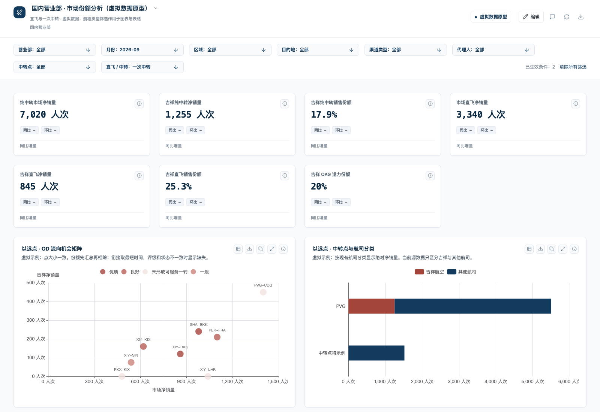

# 动态图表验收记录

日期：2026-10-28。先验证通用 MCP 产品，再使用虚拟看板集成验收。

## 产品验证

- `npm run runtime:test`：314 项 Python／浏览器测试、61 项 JavaScript 测试通过。
- 零售测试使用门店、商品、销售额和销量，覆盖动态系列、分组维度替换、筛选、跨数据集下钻及清除。
- 数据测试覆盖合计比例、零分母、描述字段冲突、最小分钟数、缺失组合、零值、固定大小与显式气泡编码。
- `npm pack` 完成；解包后的正式 MCP stdio 接口完成工具发现、验证、筛选查询和原子修改。
- 开发安装构建：`runtime_info.uiBuildId = 658a26e67aec`。沿用 package 1.2.0 / runtime 0.6.0 标识，本次未发布新版本。

## 虚拟看板集成

对象：`transfer-od-prototype-20261028`，第 32 版升级为第 33 版。全部组件 ID 和 15 条批注保持不变。国内真实数据看板未修改。

| 筛选 | 以远点散点数 | 以前点散点数 | 服务表行数 |
| --- | ---: | ---: | ---: |
| 全部、一次中转 | 8 | 8 | 16 |
| 西安营业部、一次中转 | 4 | 4 | 8 |
| 示例代理 A、一次中转 | 2 | 2 | 4 |
| 直飞 | 8 | 8 | 0 |
| 空结果 | 0 | 0 | 0 |

五组查询均核对两张堆叠图销量合计与对应散点市场销量合计相等，逐点份额为 HO 合计 / 市场合计。筛选为读取状态，没有生成额外业务版本。服务描述以已存在的服务状态表为准，散点沿同一营业部、月份、OD、代理键复用其状态、评级和分钟数；未匹配的直飞记录不补造服务信息。

现有虚拟来源只区分吉祥航空与其他航司。以前点分类由原有 HO / other 数值展开；没有拆造 MU、CA 等数据。产品多系列能力另由三商品零售用例验证。

## 当前安装与预览

安装在仓库 `.runtime-installs/dynamic-encoding-20261028/package`。analyst-workspace 主目录及指定工作树的 `.codex/config.toml` 已更新入口。新安装包的本地浏览器预览已验证营业部、直飞筛选和服务表空结果，未记录浏览器运行错误。

已存在的 Codex MCP 连接不会自动替换已加载的 Python 模块和前端资源。重新连接项目的 charts-design MCP，再调用 `dashboard_preview`，参数为 `{"dashboardId":"transfer-od-prototype-20261028"}`。用 `runtime_info` 确认构建为 `658a26e67aec`、看板版本为 33；关闭旧预览，打开新返回的预览。不能把旧宿主页面视为已升级。

能力边界与可复用声明见 [动态图表声明](dynamic-encoding.md)。工程跟踪：[INS-221](https://linear.app/insightal/issue/INS-221)。
