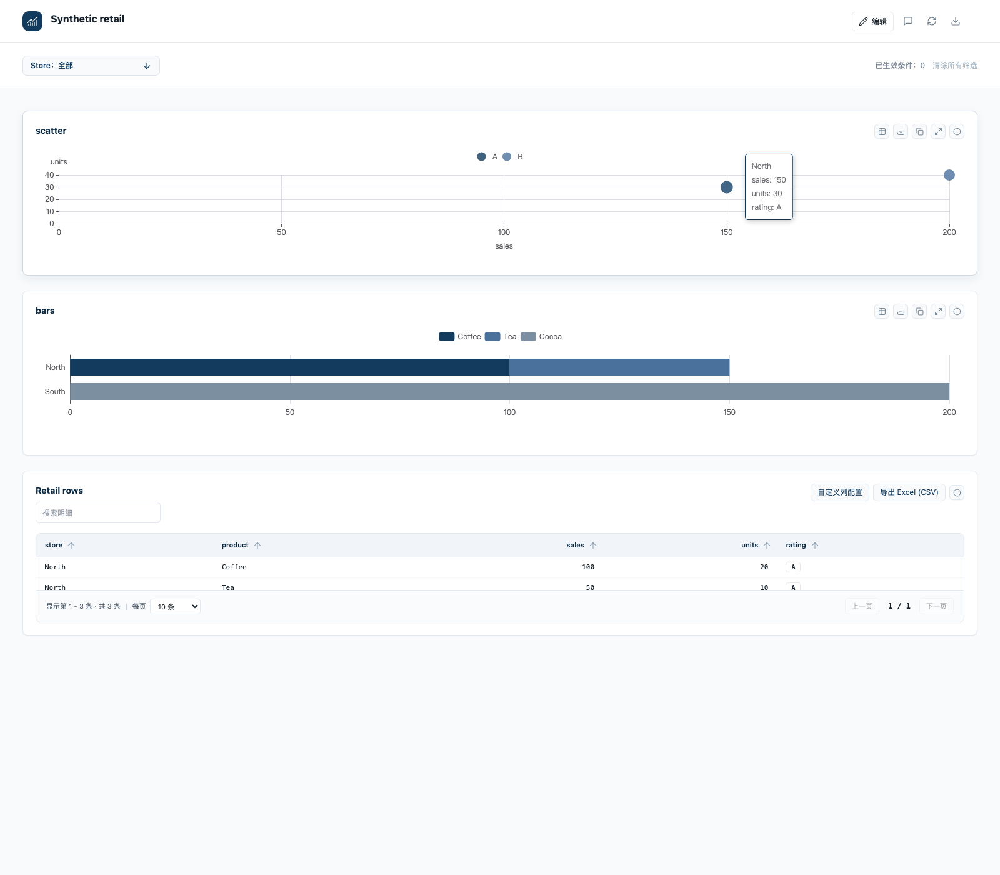

# 动态图表声明

`chart_declarations` 返回 `dynamicEncoding`。在原有 `r02` 或 `c03` 的 `config.encoding` 中启用；组件仍使用稳定 ID，原有编辑、批注和历史记录继续保留。旧声明不需要迁移。

```json
{
  "kind": "legacy", "family": "chart", "title": "门店商品销售",
  "datasetId": "sales",
  "config": {
    "code": "c03", "data": {}, "presentation": {},
    "encoding": {"orientation": "horizontal", "stacked": true,
      "colors": {"Coffee": "#123B5D", "Tea": "#A4453C"}}
  },
  "binding": {"datasetId": "sales", "categoryField": "store", "seriesField": "product",
    "measures": {"value": "sales-total"},
    "orderBy": {"target": "value", "direction": "desc"}}
}
```

`categoryField` 可换成区域、代理、部门或其他已声明字段。系列从筛选后的数据产生，没有固定系列数。堆叠为绝对值，仅接受 sum/count；不自动归一化为百分比。缺失组合保留 null，零值保留 0。长标签在轴上截短，提示框和数据表保留全文。

散点使用 `r02`，绑定 `categoryField` 与 `measures.x/y`。`symbolSize` 默认 18，所有点等大；只有明确指定 `sizeBy` 才启用面积编码。`colorBy` 指向已绑定字段，`colors` 映射分类值到颜色。`tooltip` 是已绑定键的有序数组；显示格式来自指标的 format、unit 和 decimals。提示框不执行 JavaScript 字符串。`showLabels` 控制点标签。

描述字段放在 `binding.attributes`：例如 `minutes: {field: "minutes", aggregation: "min", label: "最短时间", unit: "分钟"}`。`min/max` 仅用于数值并忽略 null；`unique` 仅在组内每行非空且值一致时返回该值，否则返回 null。分类缺失显示“缺失”。缺少 x 或 y 的观测不生成散点；空结果显示“当前筛选无数据”。

比例使用既有 `ratio` 指标：先对筛选后分子、分母分别求和，再相除；分母为零或全空返回 null。不要把行百分比再求平均。动态编码不接受 binding.scale，单位与格式在指标中声明。

跨数据集下钻需要组件明确配置相同 `linkGroup`，目标还必须有同名字段。单击散点按分类字段联动，再次单击或清除联动恢复。只有业务含义一致的字段才应放入同一联动组。

## 覆盖范围

| 场景 | 声明路径 | 本次验证 |
| --- | --- | --- |
| 数值卡 | 既有 KPI 与指标绑定 | 既有回归测试 |
| 比较、排名 | c01/c02；c03 动态编码 | 动态分类排序 |
| 横纵分组/堆叠柱 | c03 + orientation/stacked | 零值、缺失组合、三系列、筛选后系列变化 |
| 趋势、多指标 | 既有 t 系列及绑定 | 未扩展其声明边界 |
| 散点、固定点、气泡 | r02 动态编码 | 等大、显式 sizeBy、缺失、比例重算 |
| 占比 | 既有占比图；ratio 指标 | 零分母与加权比例 |
| 明细表 | 既有 table | 沿用明细分页；不是自动聚合表 |
| 筛选、下钻 | 显式消费者、linkGroup | 同字段跨数据集需显式加入 |

新编码暂不支持 timeGrain、双轴或自动聚合服务状态表。无需时间归并的日期可直接作为分类字段。不是所有 ECharts 组合都属于已验证范围。业务规则、行业颜色及评级排序由调用方声明，产品不内置航空规则。

## 复验入口

- `node --test tests/runtime/encoding.test.mjs`：固定点、比例、空结果、描述字段冲突、动态系列及零售分组。
- `node bin/python-runtime.js -m pytest tests/runtime/test_encoding.py -q`：SQL 聚合、字段校验和工具发现。
- `node bin/python-runtime.js -m pytest tests/runtime/test_encoding_browser.py -q`：零售场景真实浏览器渲染、筛选后系列减少、明细同步、跨数据集下钻及清除。
- `npm run runtime:test`：现有运行时兼容回归。测试使用项目登记的 Python 依赖和 Chromium；macOS 沙盒可能需要允许启动无界面浏览器。
- `npm pack --pack-destination /private/tmp`：按项目正式入口生成安装包。安装包中的 `runtime_info.uiBuildId` 用于区分开发构建；本次不发布新版本。


