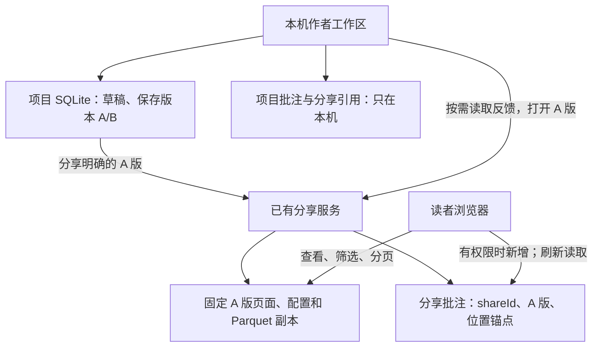

# 本机编辑与独立分享批注：2026-11-27 定向验证

## 对象与范围

基于 [PR #23](https://github.com/dabaige53/charts-design/pull/23) 的最新提交 `844b5b4c93102e6706cb33a60dd846c7bf645a9c`，本机分支为 `feat/local-shared-annotations`。开始时当前工作目录没有检出仓库；检出上述提交后工作树干净，没有覆盖其他未提交工作。交付前再次读取 PR，头提交未改变。

本轮只处理「本机制作 → 分享明确保存版 → 读者查看与批注 → 作者按需查看原版反馈」，保留本地 stdio、远程 HTTP MCP、既有编辑与预览链接、正式发布、密钥访问、到期撤销清理和静态 ZIP。没有发布标签、生产部署、执行数据库迁移或迁移业务数据。

开始验证前已说明范围：新 HTTP 权限与持久化、原版本锚点、独立进程分享、相关 React 交互、分享存储适配，以及 PR #23 的直接兼容边界。只运行定向测试；没有运行全量测试或触发完整 CI。新增、修改用例均带 `@wu-test`。

## 原有链路与本轮补齐位置

| 链路 | 原有能力 | 本轮补齐 |
| --- | --- | --- |
| `mcp_server` / `http_server` / `server` → `Service` | 共用项目、草稿、检查点与数据查询 | stdio 预览回执提供 loopback 浏览器链接；本机增加明确的 `/edit/<id>`、`/view/<id>` |
| 共享 `DashboardApp` / `PositionComments` | 组件、段落和区域锚点、独立批注保存与重试 | 内容 `readOnly` 与批注能力分离；浏览器批注使用 HTTP，MCP 宿主提供打开浏览器的入口 |
| `ProjectStore` / `CloudProjectStore` | 批注状态独立于内容版本 | 按实际展示的保存版记录上下文；当前草稿 CAS 与 `targetRevision` 分开 |
| `deployment.export_site` / `CloudShares` | 固定版本、Parquet、浏览器 Worker、密钥网关与清理 | 本机通过已授权服务导入固定副本；只使用服务已有 UI，私人批注和运行权限不外发 |
| `/s/<shareId>/` | 每文件鉴权、过期、撤销 | 独立 GET/POST 批注权限；分享之间隔离；作者反馈链接只读 |
| CloudBase / Cloudflare / Pages | COS 或私有工作区副本、既有持久化与代理 | PostgreSQL 批注 RPC、每分享 SQLite、Cloudflare 批注增量 checkpoint；Pages 仍由后端负责写入 |

实现入口分别是 `dashboard_runtime/local_shares.py`、`share_annotations.py`、现有 HTTP/分享模块，以及 `runtime-ui/src/annotation-client.ts` 和现有共享界面。没有新增批注 MCP 工具或新的账户体系。

## 用户旅程与存储

本机启动方式和服务配置的完整说明维护在[自托管服务器](../operations/self-hosted-server.md#本机通过分享服务发布)，术语见[看板交付术语](../agent/GLOSSARY.md)。

```sh
charts-design-runtime --project-root /absolute/path/project \
  --runtime-root /absolute/path/runtime-cache serve --dashboard overview
```

启动回执中的 `editUrl` 用于编辑和版本中心，`viewUrl` 用于保存版预览与位置批注。`--view` 将预览作为回执中的默认 `url`。源码入口使用 `bun run python -- -m dashboard_runtime`。

分享时，在「版本与分享 → 版本」选择保存版本与「仅查看 / 可批注」，点击「分享此版本」。本机进程读取 `CHARTS_SHARE_SERVICE_URL`、`CHARTS_SHARE_SERVICE_TOKEN`、`CHARTS_SHARE_SERVICE_PROJECT`，只上传所需副本。作者从「版本与分享 → 分享」的对应记录点击「查看读者批注」打开原分享版本，不切换或合并当前草稿；弹窗被阻止时可通过反馈面板中的链接打开或「重新读取反馈」。



CloudBase 的副本保存在私有 COS，批注保存在 PostgreSQL；Cloudflare Containers 的副本和分享 SQLite 在工作区中，并由 Durable Object SQLite 的完整／批注增量 checkpoint 持久恢复；Neon / Pages 路径的批注由后端私有持久卷保存。纯静态 ZIP 没有批注后端，因此不显示可提交状态。

## 可观察结果

| 验收项 | 本轮证据与结论 |
| --- | --- |
| 本机预览提交位置批注，重读仍在，版本不变 | 真实 loopback HTTP 用例提交、重复提交、重建 Service 后读取；内容版本与历史数量不变；锚点使用展示版 |
| A 分享后保存 B，工作区预览 B，原分享 A | 独立进程 HTTPS 旅程实际保存 B 后核对两个入口的 revision；原分享文档和数据字节保持不变 |
| 读者批注与原版反馈 | 分享 HTTP 与作者本机代理往返；重开反馈返回 A 版及原锚点；看板组件和报告段落各有代表用例；同版两个分享互不污染 |
| 停止作者后分享继续工作 | 实际终止作者子进程；独立分享子进程继续提供页面、Parquet 和批注 GET/POST；下载的数据交给真实打包 Worker，验证筛选、分页与缓存；重启分享服务后批注仍在，再重启作者读取反馈 |
| 权限隔离 | 旧 view 令牌不获得写权限；仅查看分享写入被拒；可批注分享不能调用内容、版本、发布或管理批注接口；跨分享、过期和撤销请求被拒；反馈会话不能升级写权限；物理清理后重放旧发布请求也不能复活原链接 |
| 旧入口和交付兼容 | 真实 stdio / Streamable HTTP MCP 定向检查通过；旧 JSON 分享、Parquet 分享、多页替换、静态 ZIP、SQLite 连接释放与查询语义定向回归通过 |

浏览器 UI 的按钮、权限与重试交互由 React/jsdom 定向用例验证。实际普通浏览器验收未完成：Playwright 环境没有可用 Chromium，下载失败；CUA 打开本机服务返回 `net::ERR_CONNECTION_REFUSED`，随后 URL 访问策略拒绝页面读取，已停止该路径，没有尝试绕过。不能将 HTTP 或 React 测试写成真实浏览器点击／视觉验收，也未验证特定 MCP 宿主的实际打开链接行为。

## 已执行定向检查

测试环境使用仓库锁定依赖：Python 3.11.16、Bun 1.3.8、uv 0.12.13。Parquet 使用 PR #23 已成功 CI 的原生程序，没有新触发 CI 或重新编译 Rust：运行 [45835171783](https://github.com/dabaige53/charts-design/actions/runs/45835171783)，产物 `15123832832`，下载 ZIP 的 SHA-256 为 `219191a81221e09f1bb2254df5d27b60e263523604b05894afaf78b3416b09d7`，执行版本输出 `charts-design-core 0.1.0`。

| 范围 | 不同用例数 | 结果 |
| --- | ---: | --- |
| 本机入口、权限、原版锚点、持久分享引用、导出清洗 | 6 | 通过；`test_local_workspace.py` |
| 既有本机 HTTP 与空闲生命周期 | 4 | 通过；包含真实 stdio 退出 |
| 新分享批注、并发、HTTP 权限、ZIP 导入与退役恢复 | 11 | 通过；`test_share_annotations.py`，含 4 个退役组合与 3 个崩溃故障点 |
| PR #23 既有分享兼容 | 7 | 通过；旧 JSON 转 Parquet、复用、上传失败重试、7/30 天到期、A/B 固定版本、多页 JSON/Parquet |
| 远程工作区、CloudBase/Neon 上下文、真实双进程旅程 | 4 | 通过；`test_publication_journey.py`，两个数据库路径使用现有数据库边界替身 |
| 既有 stdio / 远程 MCP、静态导出、连接生命周期 | 7 | 通过；含 SQLite 提交／回滚／提交失败三个参数用例 |
| 共享 React 批注、静态页、版本中心与入口 | 14 | 通过；只运行相应测试文件 |
| Pages 精确代理与 Cloudflare checkpoint | 7 | 通过；5 个 Pages、2 个 checkpoint 用例 |
| Parquet / JSON 筛选、比率、明细与 CSV 查询一致性 | 1 | 通过；实际原生 Parquet 与 JS 查询 |

合计 **61 个不同定向用例通过**，重复执行同一用例不重复计数。退役回归覆盖仅查看／可批注与主动撤销／自然到期的四个组合；清理后重新创建服务对象，原 requestId、原密钥与快捷重试持续被拒。三个故障参数覆盖 claim 后未写 job、控制记录已写但 scope 尚未激活、scope 已激活但 intent 未删除；已激活副本不能误删，未完成副本可回收。

独立复审补上了两条恢复边界：快捷重试必须完成／确认 scope 激活后才能返回成功；退役后迟到写入必须有后续清理途径。既有定时清理会根据永久退役 ID 复扫迟到文件，即使上传进程未执行到最终激活步骤便退出也能回收。退役标记只保留随机分享 ID；SQL scope 清空作者、页面和摘要，批注全部删除。复扫只发生在清理中，批注提交仍只保存批注。

主要复现命令（其余用例名称与边界在对应测试的 `@wu-test` 标记中）：

```sh
bun run python -- -m pytest -q tests/runtime/test_local_workspace.py \
  tests/runtime/test_publication_journey.py tests/runtime/test_share_annotations.py

bun run python -- -m pytest -q \
  tests/runtime/test_mcp.py::test_real_stdio_protocol \
  tests/runtime/test_server.py::test_remote_mcp_and_scoped_viewer_api \
  tests/runtime/test_deployment.py::test_site_export_contains_runtime_and_preserves_document \
  tests/runtime/test_deployment.py::test_parquet_site_uses_saved_version_and_reuses_immutable_data \
  tests/runtime/test_project.py::test_store_connections_close_after_commit_and_rollback

bun test tests/deploy/cloudflare-checkpoint.test.mjs tests/deploy/pages.test.mjs

cd runtime-ui
bun test src/annotation-client.test.ts src/position-comments.test.tsx \
  src/static.test.tsx src/version-center.test.tsx src/dashboard-reading.test.tsx \
  src/web-access-flow.test.tsx
CHARTS_CORE_BIN=/absolute/path/charts-design-core bun test src/static-data.test.ts \
  -t 'Parquet and JSON feed identical filters, ratios, details and CSV exports'
```

初次定向测试暴露过测试夹具字段错误、Bun 路径和局部 UI 测试生命周期问题，修正后只重跑失败项。远程 MCP 测试首次受当前环境的 SOCKS 代理依赖影响，在仅含 loopback 请求的测试进程中清除代理环境后通过；未新增依赖或放宽断言。真实独立旅程增加 Worker 查询断言、最终激活逻辑修复后单独重跑通过。退役模块 11 项通过后，最后只重跑发生变化的 3 个崩溃参数项，均通过。

相关 Python 文件 Ruff、TypeScript 类型检查、部署脚本语法检查和 `git diff --check` 均通过。为本机预览与导出运行 `bun run ui:prepare`，得到源码匹配的 UI 构建 `0ca71ab43a62110c`；忽略提交的构建和原生二进制不进入 Git。

## 真实云环境核对与边界

本轮没有可用的 CloudBase、Cloudflare 或目标服务器凭据。已只读查看仓库源码、部署工作流与历史运行记录：

| 平台 | 已观测证据 | 本轮能确认的范围 |
| --- | --- | --- |
| CloudBase | [CloudBase release 45772469145](https://github.com/dabaige53/charts-design/actions/runs/45772469145) 成功，提交 `2fecfa41b8b42c1a3258c38a401295d89fa37352`；本轮请求文档中的服务 `/health` 返回 403 | 历史发布曾成功；不能证明本轮代码已上线或数据库可写 |
| Cloudflare Containers | 同一发布提交的 [Cloudflare release 45772469113](https://github.com/dabaige53/charts-design/actions/runs/45772469113) 为 skipped | 仓库提供实现；本地模拟 checkpoint 通过，未做真实 Worker/Container/DO 写入验收 |
| 自有服务器 / Neon / Pages | [Server and Pages release 45571900788](https://github.com/dabaige53/charts-design/actions/runs/45571900788) 成功 | 该工作流构建发布包，不等于实际生产部署；本轮只验证后端协议与 Pages 代理 |

CloudBase 的新可批注分享和本机发布桥需要执行新增 `20261127010000_share_annotations.sql`，本轮只提交迁移源码，未在真实 PostgreSQL 执行。服务器工作区既有仅查看分享不依赖该新 RPC；本机 ZIP 导入即使选择仅查看，仍需要 RPC 原子登记请求。

上线前仍需在被授权的实际服务执行该迁移／服务升级，再验证读者提交、刷新、作者反馈与平台重启持久化。已有部署记录、源代码支持、本地测试通过、真实云验证是四个不同状态；本轮完成代码实现和本地定向验证，并只读核对历史部署记录。
